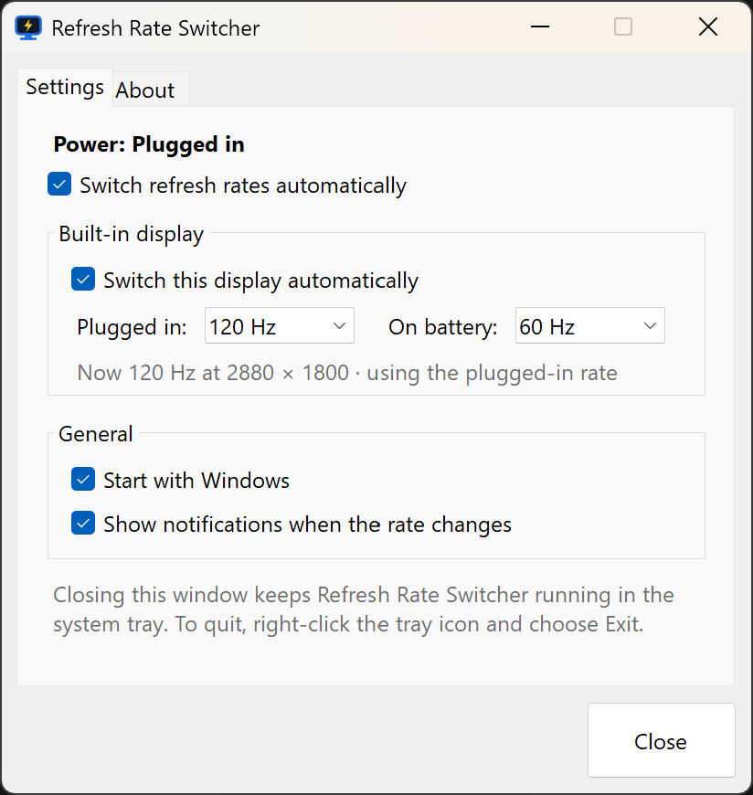
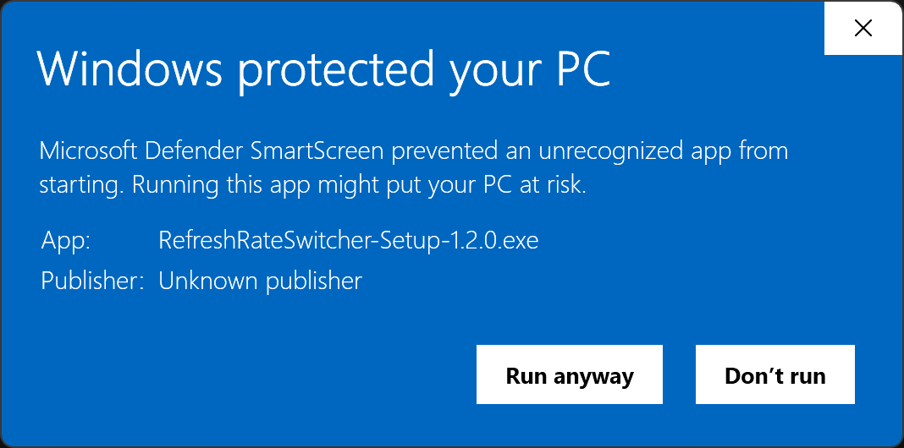
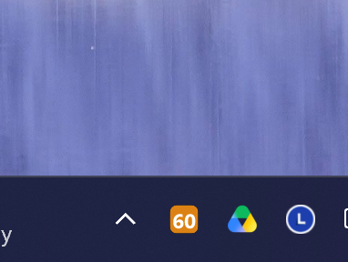
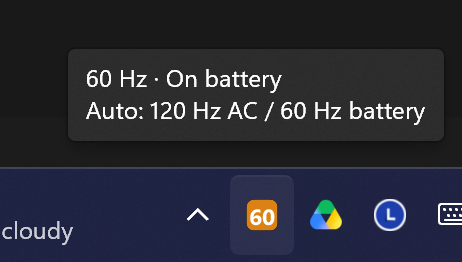
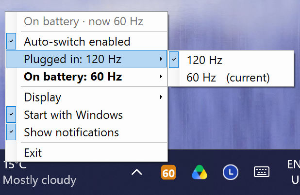
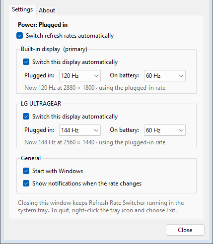

# Refresh Rate Switcher

## About
High refresh rate laptop screens look smooth but use more battery, and Windows doesn't change the
refresh rate when you unplug. Refresh Rate Switcher does it for you: choose one rate for when you're
plugged in and another for when you're on battery, and it switches automatically whenever the power
source changes. It sits in the system tray, works with multiple displays (each with its own settings),
and needs no admin rights or internet access.

> [!WARNING]
> **Not compatible with Windows 11 Dynamic refresh rate (DRR).** The app sets a *fixed* rate as soon as it
> starts, before you open its settings, which turns DRR ("Dynamic (xx Hz)") off. If you rely on DRR, don't
> install it. See [Known limitations](#known-limitations) for how to restore DRR.

This is a one-person hobby project I made to fix a personal annoyance. To report a problem or make a
suggestion, use GitHub's [private reporting form](../../security/advisories/new) (only I can see it; there's
no public issue tracker). I'll look at reports when I can, but please forgive me if I'm slow to respond.

## Install
Download `RefreshRateSwitcher-Setup-<version>.exe` from the [latest release](../../releases/latest) and run it. It installs per-user (no admin) to
`%LOCALAPPDATA%\Programs\Refresh Rate Switcher`, adds a Start Menu entry, and registers
in Settings → Apps → Installed apps. Running the setup again upgrades in place and keeps your settings.

Setup asks whether to **start the app when you sign in to Windows** (recommended; you can change it later).
For silent installs, use `/S`, and add `/NOSTARTUP` to skip the startup entry.

On first run, the built-in laptop screen is set to switch between its highest rate when plugged in and
60 Hz (or its lowest rate) on battery. External monitors are left alone until you turn them on in Settings,
with one exception: on a PC with no built-in screen (a desktop), the main monitor is switched from the start.

### Security warnings
The installer and app are **not code-signed**, so Windows may warn you the first time:
- **SmartScreen** ("Windows protected your PC"): click **Run anyway**. On some versions of Windows,
  click **More info** first.
- **Antivirus**: some products may flag unsigned installers like this one. Setup asks a running copy of the
  app to exit before upgrading; only for versions before 1.2.2, which don't understand that request, does it
  stop the process running from the install folder (never other programs with the same name).

Every release is built by [GitHub Actions](../../actions/workflows/release.yml) directly from the source in
this repository, so you can see exactly what went into it. If you'd rather not trust a pre-built binary,
[build it from source](#build-from-source).

To check that a download is genuine (from the next release on): each release lists the installer's SHA-256
checksum in `SHA256SUMS.txt` (compare it with `Get-FileHash RefreshRateSwitcher-Setup-<version>.exe` in
PowerShell), and carries a signed record that GitHub Actions built it from this repository
(`gh attestation verify RefreshRateSwitcher-Setup-<version>.exe --repo noelchan127/refresh-rate-switcher`).

## Use
The tray icon shows the current refresh rate: **blue** when plugged in, **amber** on battery, **grey** when auto-switch is off.
Hover over it to see both settings.

| Plugged in | On battery | Tooltip |
|:---:|:---:|:---:|
|  |  |  |

Click the icon to show the quick menu:

- **Settings…**: opens the settings window
- **Auto-switch enabled**: master on/off toggle
- **Plugged in ▸ / On battery ▸**: pick the rate for each state. With more than one display,
  each display gets its own submenu, including **Switch this display**.
- **Start with Windows**, **Show notifications**, **About**, **Exit**

### Settings window
Open it from **Settings…** in the tray menu, or from the Start Menu. Each connected display has its own
section: tick **Switch this display automatically** and choose its plugged-in and battery rates.
Changes apply immediately. Closing the window keeps the app running in the tray.

 
Example with an external monitor connected

Settings follow the monitor rather than the port, so a monitor keeps its settings when you plug it into a
different port or dock. Two identical monitors (same make and model) are told apart by the port they were
last connected to: plugging in a second one doesn't change the first one's settings, but if you swap their
cables, they swap settings.

The **About** tab shows the version, licence and links to the latest release and the source code.
The app itself never connects to the internet, so it doesn't check for updates automatically:
to update, download the latest installer and run it. **Copy system info** copies your display details,
which is useful in a bug report.

When the power source changes it switches the rate and, if notifications are on, tells you:

 

It's lightweight and uses very few resources: it sleeps until the power source or display setup changes,
so it uses no CPU while idle. The settings window is only created when you open it and is freed again
when you close it.

## Uninstall
Settings → Apps → Installed apps → Refresh Rate Switcher → Uninstall.
This closes the app and removes files, the Start Menu entry, the startup entry and saved settings.

## Known limitations
- **Not compatible with Windows 11 Dynamic refresh rate (DRR).** This app sets a *fixed* refresh rate,
  which turns DRR ("Dynamic (xx Hz)" in Settings) off, and Windows offers no way for apps to turn it back on.
  If you rely on DRR, don't use this app (or turn off auto-switch). To restore DRR after uninstalling,
  re-select it in Settings → System → Display → Advanced display → Choose a refresh rate.
- Laptop vendor utilities (e.g. Armoury Crate, Lenovo Vantage, Dell/HP tools) that also change the refresh rate
  on power events will conflict with this app. Turn that feature off in the vendor tool.
- Displays set to **Duplicate** share one refresh rate, so they appear as a single entry.
- If you change a display's rate yourself in Windows Settings, the app leaves it until the next time you
  plug in or unplug, or the PC wakes from sleep (some drivers reset the rate on wake, so it's set again then).

## Build from source
`dotnet build -c Release` (needs the .NET SDK; the .NET Framework 4.8 reference assemblies come from NuGet automatically).

Installer: `makensis installer.nsi` (NSIS 3) after building; output goes to `out\`.

Tests: `RefreshRateSwitcher.exe --selftest <folder>` checks the Windows display APIs on your machine
(without changing anything), the settings logic and the window layout, and writes a report and preview
images to the folder. GitHub Actions also runs [`.github/scripts/test-windows.ps1`](.github/scripts/test-windows.ps1),
which installs, upgrades, runs and uninstalls the app on Windows for every change, and
[`.github/scripts/test-hardware.ps1`](.github/scripts/test-hardware.ps1), which runs the app with virtual
monitors (several refresh rates, plugged in and out) and a simulated charger, sleep and wake.

## Reporting problems and security issues
Bugs, suggestions and security problems all go through the same
[private reporting form](../../security/advisories/new). See [SECURITY.md](SECURITY.md) for details.

## License
Copyright (C) 2026 Noel Chan

This program is free software: you can redistribute it and/or modify it under the terms of the
GNU General Public License as published by the Free Software Foundation, either version 3 of the
License, or (at your option) any later version. It is distributed WITHOUT ANY WARRANTY; see
[LICENSE](LICENSE) for the full terms.

