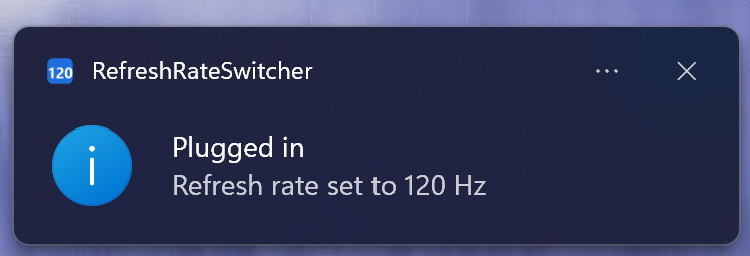
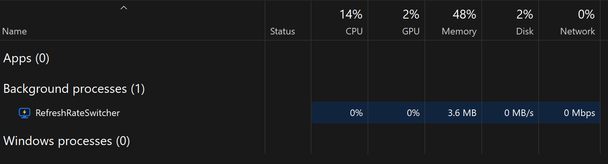

# Refresh Rate Switcher

Windows tray app that sets the display refresh rate automatically depending on whether
the laptop is plugged in or on battery.

## Install
Download `RefreshRateSwitcher-Setup-<version>.exe` from the [latest release](../../releases/latest) and run it. It installs per-user (no admin) to
`%LOCALAPPDATA%\Programs\Refresh Rate Switcher`, adds a Start Menu entry, and registers
in Settings → Apps → Installed apps. Running the setup again upgrades in place and keeps your settings.

On first run the app picks max Hz for plugged in, 60 Hz (or the lowest) for battery,
and enables "Start with Windows".

### Security warnings
The installer and app are **not code-signed**, so Windows may warn you the first time:
- **SmartScreen** ("Windows protected your PC"): click **More info → Run anyway**.
- **Antivirus**: some products may flag unsigned installers like this one, partly because setup closes a
  running copy of the app before upgrading. This is a false positive.

Every release is built by [GitHub Actions](../../actions/workflows/release.yml) directly from the source in
this repository, so you can see exactly what went into it. If you'd rather not trust a pre-built binary,
[build it from source](#build-from-source).

## Use
The tray icon shows the current refresh rate: **blue** when plugged in, **amber** on battery, **grey** when auto-switch is off.
Hover over it to see both settings.

| Plugged in | On battery | Tooltip |
|:---:|:---:|:---:|
|  |  |  |

Click the icon (or open the app from the Start Menu while it's running) to show the menu:
- **Auto-switch enabled**: master on/off toggle
- **Plugged in ▸ / On battery ▸**: pick the rate for each state
- **Display ▸**: Automatic = built-in laptop panel (falls back to primary display)
- **Start with Windows**, **Show notifications**, **Exit**

When the power source changes it switches the rate and, if notifications are on, tells you:

 

It's lightweight: about 9 MB of memory and no CPU use while idle, since it only wakes up on power and display events.

## Uninstall
Settings → Apps → Installed apps → Refresh Rate Switcher → Uninstall.
This closes the app and removes files, the Start Menu entry, the startup entry and saved settings.

## Known limitations
- **Not compatible with Windows 11 Dynamic refresh rate (DRR).** This app sets a *fixed* refresh rate,
  which turns DRR ("Dynamic (xx Hz)" in Settings) off, and Windows offers no way for apps to turn it back on.
  If you rely on DRR, don't use this app (or turn off auto-switch). To restore DRR after uninstalling,
  re-select it in Settings → System → Display → Advanced display → Choose a refresh rate.
- Laptop vendor utilities (e.g. Armoury Crate, Lenovo Vantage, Dell/HP tools) that also change the refresh rate
  on power events will conflict with this app. Turn that feature off in the vendor tool.

## Build from source
`dotnet build -c Release` (needs the .NET SDK; the .NET Framework 4.8 reference assemblies come from NuGet automatically).

Installer: `makensis installer.nsi` (NSIS 3) after building; output goes to `out\`.

## Security
To report a security problem, please see [SECURITY.md](SECURITY.md). Don't post it in a public issue.

## License
Copyright (C) 2026 noelchan127

This program is free software: you can redistribute it and/or modify it under the terms of the
GNU General Public License as published by the Free Software Foundation, either version 3 of the
License, or (at your option) any later version. It is distributed WITHOUT ANY WARRANTY; see
[LICENSE](LICENSE) for the full terms.

